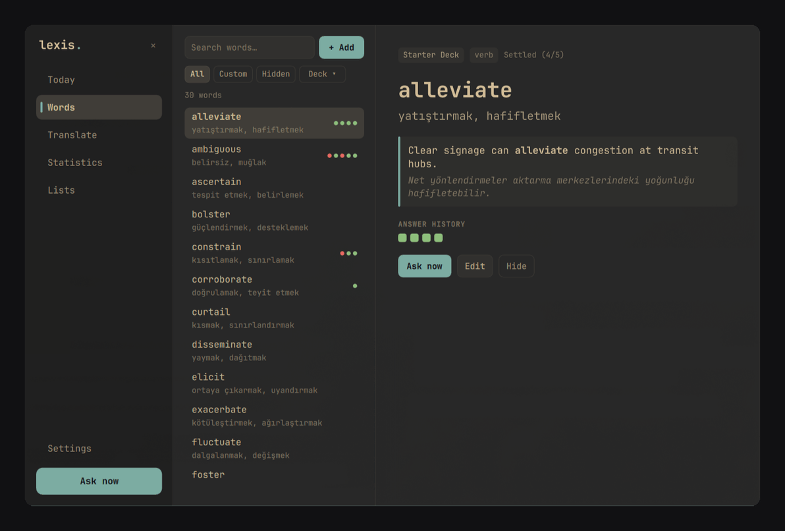

# Lexis (`l.`)

> Ambient vocabulary habit plugin for **Omarchy 4.x** (`omarchy-shell` / Quickshell + Hyprland).
> Türkçe dokümantasyon: [`README.tr.md`](./README.tr.md)



Lexis builds a quiet, everyday vocabulary habit while you work. Every few minutes (default **5 min**), a small notification-like question card appears in the top-right corner **without stealing keyboard focus** from your terminal, editor, or browser — and stays patiently until you answer, skip (`✕`), or hide (`Don't show again`) the word.

---

## Highlights

- **Zero-focus-steal corner question cards:** Built on `WlrLayer.Overlay` with `WlrKeyboardFocus.None` by default and a tight input region (`mask: Region`) so clicks outside the card pass straight through to your desktop. Automatically pauses while Omarchy is locked or in Do Not Disturb.
- **4-stage spaced repetition (SRS):**
  1. **Introduction card (`New word`)** — shows a new word, its meaning, an example sentence, and translation before ever quizzing you (`Got it`).
  2. **4-Choice flashcards** (`Word → Meaning` & `Meaning → Word`) with part-of-speech-matched distractors.
  3. **Mixed review** across all 4 question types as the word settles.
  4. **Typed recall** (`Word → Typed meaning` & `In context → Typed`) once a word reaches higher SRS boxes, with keyboard focus granted on demand only when you click the input box or trigger `focusToast`.
- **Any learning language pair:** Interface defaults to **English** (with **Türkçe** selectable in Settings), while your `Target language` and `Meaning language` are completely up to you (`English → Turkish`, `German → English`, `Japanese → English`, `Spanish → Turkish`, etc.).
- **One-shortcut word capture (`SUPER + SHIFT + X`):** Select any word or short phrase in a browser, PDF, or terminal and capture it straight into your `Custom` deck via `wl-paste`.
- **Hybrid Free Dictionary + Optional AI (`Off` works out of the box):**
  - **Primary Free Dictionary (zero login, zero quota):** Enriches captured words and powers the `Translate` tab via Wiktionary (`freedictionaryapi.com`), Tatoeba example pairs, and MyMemory.
  - **Optional CLI AI boost/judge:** Connect your existing **Gemini (`agy`)**, **Claude Code (`claude`)**, or **ChatGPT (`codex`)** subscription on its lowest-quota model (`gemini-3.8-flash-low`, `claude-haiku-5-5`, `gpt-5.6-luna`) for idioms missing from dictionaries and synonym grading on typed answers.
  - **Optional Local / Custom `/v1` endpoint:** 1-click presets for **Ollama** (`:11434/v1`), **LM Studio** (`:1234/v1`), **llama.cpp** (`:8080/v1`), and **OpenRouter**, with live `/v1/models` discovery.
- **CSV, TSV & numbered PDF deck import:** Includes a built-in 30-word academic starter deck, interactive 4-column CSV mapper with 10-row live preview, multi-line PDF vocabulary table parser (`pdftotext -layout`), CSV backup export, and 1-click migration from legacy `kelime.db`.
- **Live Omarchy theme sync + Gruvbox Classic:** Adapts automatically to your active Omarchy theme (`Commons.Color`) or locks to warm **Gruvbox Classic** dark mode.

---

## Adding to Omarchy

```bash
omarchy plugin add https://github.com/fatihaydost/omarchy-lexis --enable
```

Then add **Lexis** (`l.`) to your top bar from Omarchy Bar Settings (or click the `l.` indicator on the right side of the bar: **left-click** opens the quick popout, **right-click** opens the full desktop window, **middle-click** draws a question immediately).

To remove the plugin cleanly:

```bash
omarchy plugin remove io.github.fatihaydost.lexis
```

*(Your local vocabulary database in `~/.local/share/lexis/` is preserved unless you delete it yourself.)*

---

## Recommended Hyprland Keybindings

Add these optional shortcuts to `~/.config/hypr/bindings.lua` (`hl.unbind` frees Omarchy's default `SUPER + SHIFT + X` X-webapp shortcut first):

```lua
o.bind("SUPER + ALT + L", "Lexis vocabulary panel", "omarchy-shell lexis panel")
hl.unbind("SUPER + SHIFT + X")
o.bind("SUPER + SHIFT + X", "Capture selected word to Lexis", "omarchy-shell lexis addSelection")
```

Optional keyboard-only toast shortcuts:

```lua
o.bind("SUPER + ALT + RETURN", "Focus Lexis typed answer", "omarchy-shell lexis focusToast")
o.bind("SUPER + ALT + ESCAPE", "Skip active Lexis card", "omarchy-shell lexis dismissToast")
```

---

## `omarchy-shell lexis` IPC Commands

| Command | Action |
| :--- | :--- |
| `omarchy-shell lexis panel` | Toggle the 6-tab main Lexis window on the focused monitor/workspace |
| `omarchy-shell lexis tab <name>` | Open a specific tab (`today`, `words`, `translate`, `stats`, `lists`, `settings`) |
| `omarchy-shell lexis toggle` | Toggle the bar quick-popout on the focused monitor |
| `omarchy-shell lexis askNow` | Draw and show a vocabulary question card immediately |
| `omarchy-shell lexis addSelection` | Capture the currently selected word/phrase (`wl-paste`) and enrich it |
| `omarchy-shell lexis mute 60` | Pause scheduled questions for `N` minutes (`0` resumes immediately) |
| `omarchy-shell lexis focusToast` | Focus the typed answer box when a written question card is visible |
| `omarchy-shell lexis dismissToast` | Skip the active question card without penalty (or close feedback) |
| `omarchy-shell lexis close` | Close the main Lexis window |
| `omarchy-shell lexis reload` | Reload SQLite and settings snapshot from disk |
| `omarchy-shell lexis status` | Print current daily progress, countdown, and active question state as JSON |

---

## Local Data Paths & Dependencies

- **Database:** `~/.local/share/lexis/lexis.sqlite`
- **Preferences:** `~/.config/lexis/settings.json`
- **Optional `/v1` API key (`0600`):** `~/.local/state/lexis/api_key`
- **Runtime tools (standard on Omarchy 4.x):** `python3` (stdlib only — zero `pip` packages), `wl-paste` (`wl-clipboard`, for selection capture), `zenity` (for native file open/save dialogs), and `pdftotext` (`poppler`, optional, for PDF table imports).

---

## License

Released under the [MIT License](./LICENSE). See [`SECURITY.md`](./SECURITY.md) for privacy and security details.
