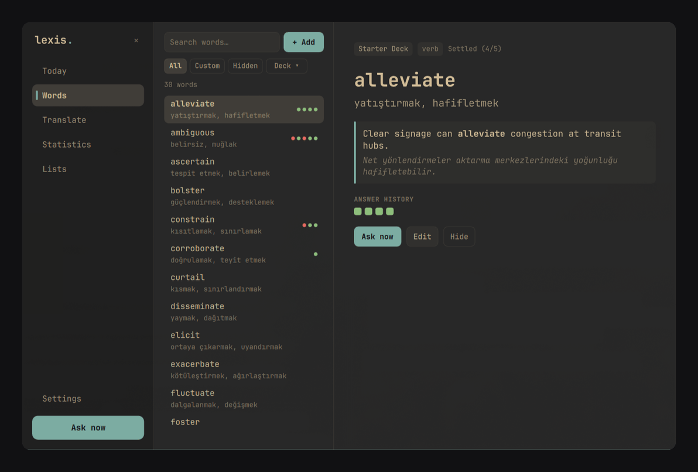

# Lexis (`l.`)

> **Omarchy 4.x** (`omarchy-shell` / Quickshell + Hyprland) için odak çalmayan, sağ üst bildirim kartlarıyla çalışan kelime alışkanlığı eklentisi.
> English documentation: [`README.md`](./README.md)



Lexis, bilgisayar başında çalışırken araya girmeyen bir kelime öğrenme alışkanlığı kurar. Belirlediğin aralıklarla (varsayılan **5 dk**) sağ üst köşede bildirim benzeri küçük bir soru kartı belirir; terminalinden veya editöründen **klavye odağını çalmaz** ve sen cevaplayana, `✕` ile atlayana ya da `Bir daha gösterme` ile gizleyene kadar kendiliğinden kaybolmaz.

---

## Öne Çıkan Özellikler

- **Odak çalmayan sağ üst soru kartı:** `WlrLayer.Overlay` ve varsayılan `WlrKeyboardFocus.None` ile çalışır; `mask: Region` sayesinde kartın dışındaki tüm tıklamalar doğrudan alttaki pencerelere geçer. Ekran kilitliyken ve Rahatsız Etme (DND) açıkken otomatik duraklar.
- **4 aşamalı aralıklı tekrar (SRS):**
  1. **Tanışma kartı (`Yeni kelime`)** — hiç görmediğin kelimeyi sormadan önce anlamı, örnek cümlesi ve cümle çevirisiyle tanıştırır (`Anladım`).
  2. **4 şıklı kartlar** (`Kelime → Anlam` ve `Anlam → Kelime`), aynı sözcük türünden seçilen çeldiricilerle.
  3. **Karma tekrar** — kelime oturdukça 4 soru tipini harmanlar.
  4. **Yazılı hatırlama** (`Kelime → Yazılı anlam` ve `Cümle içinde → Yazılı`) — yalnızca kutuya tıkladığında veya `focusToast` çağırdığında geçici klavye odağı alır.
- **İstediğin dil çifti:** Arayüz varsayılan **English** gelir, Ayarlar'dan tek tıkla **Türkçe** seçilir. Öğrendiğin dil (`Target language`) ve anlam dili (`Meaning language`) tamamen senin tercihine açıktır (`English → Turkish`, `German → Turkish`, `Japanese → English` vb.).
- **Seçili metinden tek kısayolla yakalama (`SUPER + SHIFT + X`):** Tarayıcıda, PDF'te veya terminalde seçtiğin kelimeyi `wl-paste` ile doğrudan `Custom` destene ekler.
- **Hibrit Ücretsiz Sözlük + İsteğe Bağlı AI (`Kapalı` modda kutudan çıktığı gibi çalışır):**
  - **Birincil Ücretsiz Sözlük (girişsiz, kotasız):** Wiktionary (`freedictionaryapi.com`), Tatoeba örnek cümleleri ve MyMemory üzerinden anlam, örnek cümle ve çeviriyi otomatik doldurur.
  - **İsteğe bağlı CLI AI aboneliği:** Kendi **Gemini (`agy`)**, **Claude Code (`claude`)** veya **ChatGPT (`codex`)** aboneliğini en düşük kotalı modelle (`gemini-3.8-flash-low`, `claude-haiku-5-5`, `gpt-5.6-luna`) bağlayarak deyim tamamlama ve yazılı cevaplarda eş anlamlı/yazım hatası esnekliği açabilirsin.
  - **Yerel / Özel `/v1` uç noktası:** **Ollama** (`:11434/v1`), **LM Studio** (`:1234/v1`), **llama.cpp** (`:8080/v1`) ve **OpenRouter** için tek tık ön ayarlar ve canlı `/v1/models` model listeleme.
- **CSV, TSV ve numaralı PDF tablo içe aktarma:** 30 kelimelik yerleşik akademik başlangıç destesi, 10 satır canlı önizlemeli 4 sütun CSV eşleyici, çok satırlı PDF tablo okuyucu (`pdftotext -layout`), CSV yedek dışa aktarma ve eski `kelime.db` veritabanından tek tık taşıma.
- **Canlı Omarchy teması + Gruvbox Classic:** Aktif Omarchy temasına (`Commons.Color`) canlı uyum sağlar veya tek tıkla sıcak **Gruvbox Classic** koyu temasına sabitlenir.

---

## Omarchy'ye Ekleme

```bash
omarchy plugin add https://github.com/fatihaydost/omarchy-lexis --enable
```

Üst barda sağ taraftaki `l. 0/50` göstergesine **sol tık** hızlı açılır menüyü, **sağ tık** 6 sekmeli ana pencereyi açar, **orta tık** hemen yeni soru çeker.

Eklentiyi kaldırmak için:

```bash
omarchy plugin remove io.github.fatihaydost.lexis
```

---

## Önerilen Hyprland Kısayolları (`~/.config/hypr/bindings.lua`)

Omarchy varsayılan olarak `SUPER + SHIFT + X` kısayolunu X web uygulamasına bağladığı için önce `hl.unbind` ile boşa çıkarılır:

```lua
o.bind("SUPER + ALT + L", "Lexis kelime paneli", "omarchy-shell lexis panel")
hl.unbind("SUPER + SHIFT + X")
o.bind("SUPER + SHIFT + X", "Seçili kelimeyi Lexis'e ekle", "omarchy-shell lexis addSelection")
```

---

## `omarchy-shell lexis` IPC Komutları

| Komut | İşlev |
| :--- | :--- |
| `omarchy-shell lexis panel` | Ana Lexis penceresini aç / kapat |
| `omarchy-shell lexis tab <ad>` | Belirli bir sekmeyi aç (`today`, `words`, `translate`, `stats`, `lists`, `settings`) |
| `omarchy-shell lexis toggle` | Üst bar hızlı menüsünü aç / kapat |
| `omarchy-shell lexis askNow` | Sağ üstte hemen yeni bir soru kartı göster |
| `omarchy-shell lexis addSelection` | Seçili kelime/ifadeyi yakala ve sözlükten tamamla |
| `omarchy-shell lexis mute 60` | Soruları `N` dakika sustur (`0` hemen devam ettirir) |
| `omarchy-shell lexis focusToast` | Yazılı soru kartındaki cevap kutusuna odaklan |
| `omarchy-shell lexis dismissToast` | Aktif soru kartını cezasız atla |
| `omarchy-shell lexis close` | Ana pencereyi kapat |
| `omarchy-shell lexis reload` | Diskteki SQLite ve ayar anlık görüntüsünü yeniden yükle |
| `omarchy-shell lexis status` | Günlük ilerleme ve aktif soru durumunu JSON olarak yazdır |

---

## Yerel Veri Yolları

- **Veritabanı:** `~/.local/share/lexis/lexis.sqlite`
- **Ayarlar:** `~/.config/lexis/settings.json`
- **İsteğe bağlı `/v1` API anahtarı (`0600`):** `~/.local/state/lexis/api_key`

---

## Lisans

[MIT Lisansı](./LICENSE) ile yayınlanmıştır. Güvenlik ve gizlilik ayrıntıları için [`SECURITY.md`](./SECURITY.md) dosyasına bakabilirsin.
